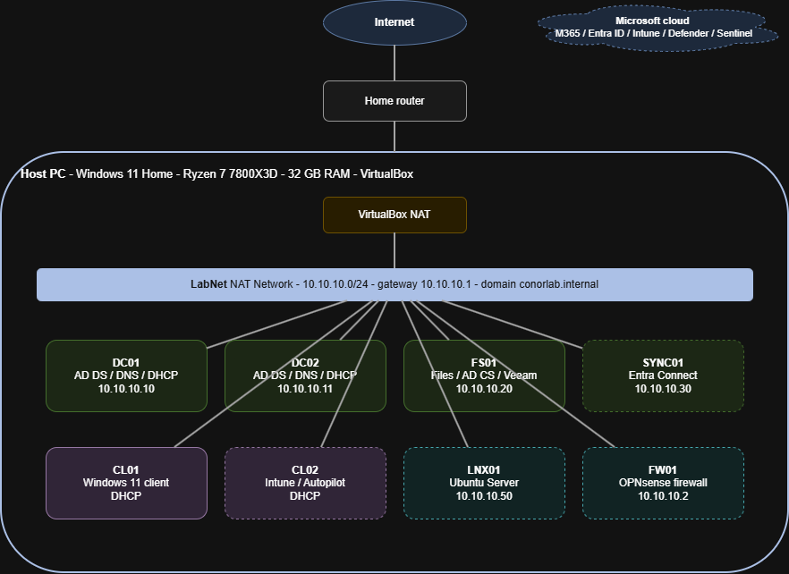

# Homelab

Hands-on lab for building and securing a hybrid Microsoft environment: Windows Server and Active Directory, Microsoft 365 / Entra ID, Intune, Defender and Microsoft Sentinel, plus Linux and network security.

Built alongside my day-to-day IT work to go deeper on systems administration, modern workplace and security operations.

## Hardware

| Component | Spec |
|---|---|
| CPU | AMD Ryzen 7 7800X3D (8 cores / 16 threads) |
| RAM | 32 GB |
| Storage | 500 GB free on SSD |
| Host OS | Windows 11 Home |
| Hypervisor | Oracle VirtualBox |

## Network

- **Lab network:** VirtualBox NAT Network `LabNet`, `10.10.10.0/24`, gateway `10.10.10.1`
- **Domain:** `conorlab.internal` (NetBIOS: `CONORLAB`)
- **DNS:** DCs forward to 1.1.1.1 / 8.8.8.8. All other machines use DC01 then DC02.
- **DHCP:** served by DC01/DC02 (failover) from week 4. VirtualBox DHCP disabled.

| Range | Use |
|---|---|
| 10.10.10.1 | Gateway (VirtualBox NAT) |
| 10.10.10.10–19 | Domain controllers |
| 10.10.10.20–49 | Member servers |
| 10.10.10.50–69 | Linux / network devices |
| 10.10.10.100–200 | DHCP pool (clients) |

## Virtual machines

| VM | OS | Role | IP | RAM | Status |
|---|---|---|---|---|---|
| DC01 | Windows Server 2025 | AD DS, DNS, DHCP | 10.10.10.10 | 4 GB | Planned |
| DC02 | Windows Server 2025 Core | AD DS, DNS, DHCP failover | 10.10.10.11 | 2 GB | Planned |
| FS01 | Windows Server 2025 | File services, DFS, AD CS, Veeam | 10.10.10.20 | 4 GB | Planned |
| SYNC01 | Windows Server 2025 | Entra Connect | 10.10.10.30 | 4 GB | Planned |
| CL01 | Windows 11 Enterprise | Domain-joined client | DHCP | 4 GB | Planned |
| CL02 | Windows 11 Enterprise | Intune / Autopilot client | DHCP | 4 GB | Planned |
| LNX01 | Ubuntu Server LTS | Linux practice, syslog | 10.10.10.50 | 2 GB | Planned |
| FW01 | OPNsense | Firewall, VLANs, IDS | 10.10.10.2 | 2 GB | Planned |

## Naming convention

`DC` domain controller · `FS` file server · `SYNC` Entra Connect · `CL` client · `LNX` Linux · `FW` firewall

## Repo layout

| Folder | Contents |
|---|---|
| `docs/` | Build notes, runbooks and write-ups |
| `scripts/` | PowerShell scripts |
| `diagrams/` | Network diagrams (draw.io source + PNG) |

