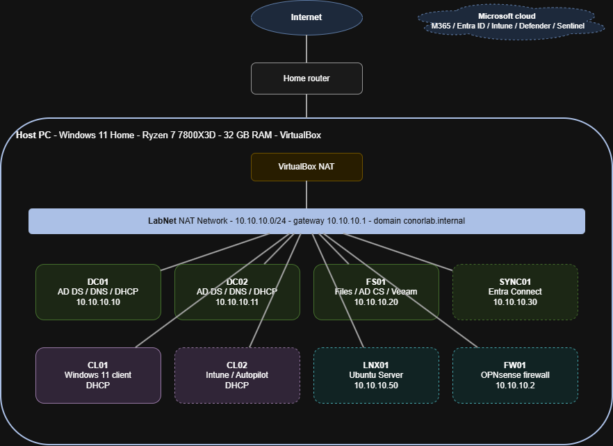

# Homelab

Hands-on lab for building and securing a hybrid Microsoft environment: Windows Server and Active Directory, Microsoft 365 / Entra ID, Intune, Defender and Microsoft Sentinel, plus Linux and network security.

Built alongside my day-to-day IT work to go deeper on systems administration, modern workplace and security operations.

## Hardware

| Component | Spec |
|---|---|
| CPU | AMD Ryzen 7 7800X3D (8 cores / 16 threads) |
| RAM | 32 GB |
| Storage | 500 GB free on SSD |
| Host OS | Windows 11 Home |
| Hypervisor | Oracle VirtualBox |

## Network

- **Lab network:** VirtualBox NAT Network `LabNet`, `10.10.10.0/24`, gateway `10.10.10.1`
- **Domain:** `conorlab.internal` (NetBIOS: `CONORLAB`)
- **DNS:** DCs forward to 1.1.1.1 / 8.8.8.8. All other machines use DC01 then DC02.
- **DHCP:** served by DC01/DC02 (failover) from week 4. VirtualBox DHCP disabled.

| Range | Use |
|---|---|
| 10.10.10.1 | Gateway (VirtualBox NAT) |
| 10.10.10.10–19 | Domain controllers |
| 10.10.10.20–49 | Member servers |
| 10.10.10.50–69 | Linux / network devices |
| 10.10.10.100–200 | DHCP pool (clients) |

## Virtual machines

| VM | OS | Role | IP | RAM | Status |
|---|---|---|---|---|---|
| DC01 | Windows Server 2025 | AD DS, DNS, DHCP | 10.10.10.10 | 4 GB | Planned |
| DC02 | Windows Server 2025 Core | AD DS, DNS, DHCP failover | 10.10.10.11 | 2 GB | Planned |
| FS01 | Windows Server 2025 | File services, DFS, AD CS, Veeam | 10.10.10.20 | 4 GB | Planned |
| SYNC01 | Windows Server 2025 | Entra Connect | 10.10.10.30 | 4 GB | Planned |
| CL01 | Windows 11 Enterprise | Domain-joined client | DHCP | 4 GB | Planned |
| CL02 | Windows 11 Enterprise | Intune / Autopilot client | DHCP | 4 GB | Planned |
| LNX01 | Ubuntu Server LTS | Linux practice, syslog | 10.10.10.50 | 2 GB | Planned |
| FW01 | OPNsense | Firewall, VLANs, IDS | 10.10.10.2 | 2 GB | Planned |

## Naming convention

`DC` domain controller · `FS` file server · `SYNC` Entra Connect · `CL` client · `LNX` Linux · `FW` firewall

## Repo layout

| Folder | Contents |
|---|---|
| `docs/` | Build notes, runbooks and write-ups |
| `scripts/` | PowerShell scripts |
| `diagrams/` | Network diagrams (draw.io source + PNG) |

## Build log

### Week 1 – Lab foundations

- Checked host hardware: virtualisation enabled in BIOS, 32 GB RAM, 500 GB free.
- Windows 11 Home has no Hyper-V, so I used **VirtualBox**.
- Created NAT Network `LabNet` (10.10.10.0/24) with VirtualBox DHCP disabled, so the domain controllers can run DHCP later.
- Planned domain name, IP scheme, naming convention and VM sizing.
- **Decision:** used `conorlab.internal` rather than `.local`. `.local` conflicts with mDNS and can't be used for public certificates. `.internal` is reserved for private use.

### Week 2 – Server template and DC01

- Built a Windows Server 2025 template, patched it, and generalised it with **Sysprep** so each clone gets a unique SID.
- Deployed **DC01** from the template and configured its static IP (10.10.10.10), DNS and RDP, and renamed it, all with PowerShell.
- Fixed a black screen on first boot after Sysprep (VirtualBox display settings, and not interrupting the specialize phase).
- Wrote `Get-SystemInfo.ps1`, a CIM-based inventory script that exports hardware, OS and disk details to CSV.
- **Next:** promote DC01 to a domain controller and join a Windows 11 client.

**Key concepts**

| Term | What it is |
|---|---|
| **Sysprep** | A Windows tool that strips out everything unique to one install (SID, computer name, hardware-specific drivers) so it can be copied to make new machines. It's how companies build a "golden image" and deploy it to many machines. Never start the original template again after running it. |
| **Unique SID** | A Security Identifier: the unique ID Windows gives each machine (and each user and group). Clones with the same SID can cause problems in a domain, so Sysprep removes it and each clone creates a new one on first boot. |
| **Specialize phase** | The part of Windows setup that runs on the first boot after Sysprep. It detects the hardware, creates the new SID and applies machine-specific settings. It can take several minutes with a blank screen, and powering off during it can damage the install. |

### Week 3 – Active Directory and DNS

- Promoted DC01 to the first domain controller of a new forest, `conorlab.internal`, using PowerShell (`Install-ADDSForest`), after a dry run with `Test-ADDSForestInstallation`.
- Checked the AD-integrated DNS zones and SRV records clients use to find the DC (LDAP 389, Kerberos 88, GC 3268).
- Added a reverse lookup zone (10.10.10.0/24) with PTR registration, DNS forwarders, and a conditional forwarder.
- Health checked with `Get-ADDomain`, `Get-ADForest` and `dcdiag /test:dns`. All tests passed.
- **Next:** OU design, users and groups, and joining a Windows 11 client.

**Key concepts**

| Term | What it is |
|---|---|
| **Forest** | The top-level boundary of Active Directory. It holds one or more domains that share a schema (the definition of every object type) and trust each other. Creating the first DC creates the forest. |
| **AD-integrated DNS** | DNS zones stored inside Active Directory instead of in files. They replicate automatically to every DC and support secure dynamic updates, so only domain members can register records. |
| **SRV record** | A DNS record that says which server provides a service, and on which port. Domain machines use SRV records to find domain controllers. This is why domain machines must use the DC for DNS. |
| **LDAP (389)** | Lightweight Directory Access Protocol. How clients and apps query and update the directory: users, groups, computers. |
| **Kerberos (88)** | The authentication protocol AD uses. Users get tickets from the DC and use them to access services, without sending their password around the network. |
| **Global Catalog (3268)** | A searchable, partial copy of every object in the forest. Used to find objects across domains, and needed at logon for universal group membership. |
| **Reverse lookup zone** | Maps IP addresses back to names (10.10.10.10 → dc01). Used by `nslookup`, logs and security tools to show names instead of bare IPs. |
| **PTR registration** | Creating the pointer (PTR) record inside the reverse zone for a machine. Running `ipconfig /registerdns` makes Windows register its A and PTR records automatically. |
| **DNS forwarders** | Upstream DNS servers (1.1.1.1, 8.8.8.8) the DC asks for any name it doesn't host itself, which is how domain machines resolve internet names. |
| **Conditional forwarder** | A rule that sends lookups for one specific domain to a specific DNS server. Used for partner or merged companies' domains and Azure Private DNS. |

