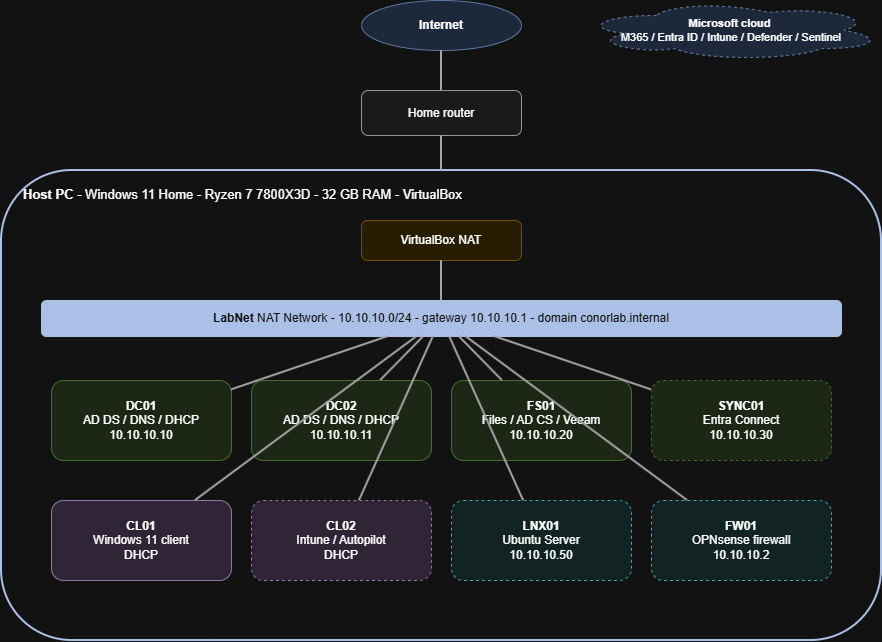

# Homelab

Hands-on lab for building and securing a hybrid Microsoft environment: Windows Server and Active Directory, Microsoft 365 / Entra ID, Intune, Defender and Microsoft Sentinel, plus Linux and network security.

Built alongside my day-to-day IT work to go deeper on systems administration, modern workplace and security operations.

## Hardware

| Component | Spec |
|---|---|
| CPU | AMD Ryzen 7 7800X3D (8 cores / 16 threads) |
| RAM | 32 GB |
| Storage | 500 GB free on SSD |
| Host OS | Windows 11 Home |
| Hypervisor | Oracle VirtualBox |

## Network

- **Lab network:** VirtualBox NAT Network `LabNet`, `10.10.10.0/24`, gateway `10.10.10.1`
- **Domain:** `conorlab.internal` (NetBIOS: `CONORLAB`)
- **DNS:** DCs forward to 1.1.1.1 / 8.8.8.8. All other machines use DC01 then DC02.
- **DHCP:** served by DC01/DC02 (failover) from week 4. VirtualBox DHCP disabled.

| Range | Use |
|---|---|
| 10.10.10.1 | Gateway (VirtualBox NAT) |
| 10.10.10.10–19 | Domain controllers |
| 10.10.10.20–49 | Member servers |
| 10.10.10.50–69 | Linux / network devices |
| 10.10.10.100–200 | DHCP pool (clients) |

## Virtual machines

| VM | OS | Role | IP | RAM | Status |
|---|---|---|---|---|---|
| DC01 | Windows Server 2025 | AD DS, DNS, DHCP | 10.10.10.10 | 4 GB | Planned |
| DC02 | Windows Server 2025 Core | AD DS, DNS, DHCP failover | 10.10.10.11 | 2 GB | Planned |
| FS01 | Windows Server 2025 | File services, DFS, AD CS, Veeam | 10.10.10.20 | 4 GB | Planned |
| SYNC01 | Windows Server 2025 | Entra Connect | 10.10.10.30 | 4 GB | Planned |
| CL01 | Windows 11 Enterprise | Domain-joined client | DHCP | 4 GB | Planned |
| CL02 | Windows 11 Enterprise | Intune / Autopilot client | DHCP | 4 GB | Planned |
| LNX01 | Ubuntu Server LTS | Linux practice, syslog | 10.10.10.50 | 2 GB | Planned |
| FW01 | OPNsense | Firewall, VLANs, IDS | 10.10.10.2 | 2 GB | Planned |

## Naming convention

`DC` domain controller · `FS` file server · `SYNC` Entra Connect · `CL` client · `LNX` Linux · `FW` firewall

## Repo layout

| Folder | Contents |
|---|---|
| `docs/` | Build notes, runbooks and write-ups |
| `scripts/` | PowerShell scripts |
| `diagrams/` | Network diagrams (draw.io source + PNG) |

## Build log

### Week 1 – Lab foundations

- Checked host hardware: virtualisation enabled in BIOS, 32 GB RAM, 500 GB free.
- Windows 11 Home has no Hyper-V, so I used **VirtualBox**.
- Created NAT Network `LabNet` (10.10.10.0/24) with VirtualBox DHCP disabled, so the domain controllers can run DHCP later.
- Planned domain name, IP scheme, naming convention and VM sizing.
- **Decision:** used `conorlab.internal` rather than `.local`. `.local` conflicts with mDNS and can't be used for public certificates. `.internal` is reserved for private use.

### Week 2 – Server template and DC01

- Built a Windows Server 2025 template, patched it, and generalised it with **Sysprep** so each clone gets a unique SID.
- Deployed **DC01** from the template and configured its static IP (10.10.10.10), DNS and RDP, and renamed it, all with PowerShell.
- Fixed a black screen on first boot after Sysprep (VirtualBox display settings, and not interrupting the specialize phase).
- Wrote `Get-SystemInfo.ps1`, a CIM-based inventory script that exports hardware, OS and disk details to CSV.
- **Next:** promote DC01 to a domain controller and join a Windows 11 client.

**Key concepts**

| Term | What it is |
|---|---|
| **Sysprep** | A Windows tool that strips out everything unique to one install (SID, computer name, hardware-specific drivers) so it can be copied to make new machines. It's how companies build a "golden image" and deploy it to many machines. Never start the original template again after running it. |
| **Unique SID** | A Security Identifier: the unique ID Windows gives each machine (and each user and group). Clones with the same SID can cause problems in a domain, so Sysprep removes it and each clone creates a new one on first boot. |
| **Specialize phase** | The part of Windows setup that runs on the first boot after Sysprep. It detects the hardware, creates the new SID and applies machine-specific settings. It can take several minutes with a blank screen, and powering off during it can damage the install. |
| **CIM** | Common Information Model: the standard way to query a Windows machine's hardware, OS and settings (for example, `Get-CimInstance Win32_OperatingSystem`). It replaced the older WMI cmdlets and works remotely over WinRM, so the same queries can run against many servers at once. |

### Week 3 – Active Directory, DNS and the first client

- Promoted DC01 to the first domain controller of a new forest, `conorlab.internal`, using PowerShell (`Install-ADDSForest`), after a dry run with `Test-ADDSForestInstallation`.
- Checked the AD-integrated DNS zones and SRV records clients use to find the DC (LDAP 389, Kerberos 88, GC 3268).
- Added a reverse lookup zone (10.10.10.0/24) with PTR registration, DNS forwarders, and a conditional forwarder.
- Health checked with `Get-ADDomain`, `Get-ADForest` and `dcdiag /test:dns`. All tests passed.
- Designed an OU structure for a 50-person company, and scripted OUs, department security groups, 12 users and a separate admin account (`Build-ADStructure.ps1`).
- Redirected new computer accounts to the Workstations OU with `redircmp`.
- Built CL01 (Windows 11 Enterprise), pointed it at DC01 for DNS and joined it to the domain. Tested by signing in as a domain user and checking group membership and Kerberos tickets.
- **Next:** DHCP, a second domain controller, and replication.

**Key concepts**

| Term | What it is |
|---|---|
| **Forest** | The top-level boundary of Active Directory. It holds one or more domains that share a schema (the definition of every object type) and trust each other. Creating the first DC creates the forest. |
| **AD-integrated DNS** | DNS zones stored inside Active Directory instead of in files. They replicate automatically to every DC and support secure dynamic updates, so only domain members can register records. |
| **SRV record** | A DNS record that says which server provides a service, and on which port. Domain machines use SRV records to find domain controllers. This is why domain machines must use the DC for DNS. |
| **LDAP (389)** | Lightweight Directory Access Protocol. How clients and apps query and update the directory: users, groups, computers. |
| **Kerberos (88)** | The authentication protocol AD uses. Users get tickets from the DC and use them to access services, without sending their password around the network. |
| **Global Catalog (3268)** | A searchable, partial copy of every object in the forest. Used to find objects across domains, and needed at logon for universal group membership. |
| **Reverse lookup zone** | Maps IP addresses back to names (10.10.10.10 → dc01). Used by `nslookup`, logs and security tools to show names instead of bare IPs. |
| **PTR registration** | Creating the pointer (PTR) record inside the reverse zone for a machine. Running `ipconfig /registerdns` makes Windows register its A and PTR records automatically. |
| **DNS forwarders** | Upstream DNS servers (1.1.1.1, 8.8.8.8) the DC asks for any name it doesn't host itself, which is how domain machines resolve internet names. |
| **Conditional forwarder** | A rule that sends lookups for one specific domain to a specific DNS server. Used for partner or merged companies' domains and Azure Private DNS. |
| **OU (Organisational Unit)** | A folder in AD for organising objects. Group Policy can be linked to OUs and admin rights delegated on them. The built-in Users and Computers folders are *containers*, which can't have GPOs linked. |
| **Global group (`GG_`)** | A security group that holds users, usually by department or role. Later combined with Domain Local groups (AGDLP) to grant access to resources. |
| **Separate admin account** | Admins use a normal account day to day and a separate `.admin` account only for admin tasks. This limits the damage if the everyday account is compromised. |
| **redircmp** | Changes where newly joined computers are placed, from the default Computers container to an OU, so Group Policy applies to them straight away. |
| **Kerberos vs NTLM** | Kerberos (the default) uses tickets from the DC and needs working DNS and clocks within 5 minutes. NTLM is an older challenge-response fallback, used when connecting by IP. It's weaker (pass-the-hash) and is being phased out. |

### Week 4 – DHCP, a second DC and replication

- Installed and authorised **DHCP** on DC01: a scope of 10.10.10.100–200 with an 8-day lease, an exclusion range for static devices, options 003/006/015, and a reservation for CL01. Moved CL01 from a static IP to DHCP and confirmed the lease.
- Built **DC02 on Server Core** and configured it from the console and remotely from DC01 with PowerShell remoting (`Enter-PSSession`, `Invoke-Command`).
- Promoted DC02 as an additional domain controller (`Install-ADDSDomainController`). Solved the **Kerberos double-hop** problem by passing `-Credential` explicitly.
- Checked replication with `repadmin /replsummary`, `repadmin /showrepl` and `dcdiag`, and proved it by creating a user on DC01 and reading it back from DC02.
- Configured **DHCP failover** (50/50 load balance) between DC01 and DC02, which copied the scope, options and reservation. Tested it by stopping DHCP on DC01 and renewing CL01's lease from DC02.
- **Next:** FSMO roles, a runbook for adding a DC, then Group Policy.

**Key concepts**

| Term | What it is |
|---|---|
| **DHCP authorisation** | A DHCP server in a domain must be authorised in AD before it hands out addresses. This stops a rogue DHCP server giving clients the wrong settings. |
| **Scope** | The range of IP addresses a DHCP server can lease out, plus its settings (subnet mask, lease length, options). |
| **Exclusion vs reservation** | An exclusion is part of the scope DHCP never hands out (used for statically configured devices). A reservation means DHCP always gives the same address to one specific device, matched by MAC address. |
| **DHCP options 003 / 006 / 015** | Settings sent with the lease: 003 the default gateway, 006 the DNS servers, 015 the DNS domain suffix. |
| **Server Core** | Windows Server without the desktop. It uses less RAM, needs fewer updates and has a smaller attack surface, so it's common for domain controllers. Managed with SConfig, PowerShell and remote tools. |
| **PowerShell remoting** | Running commands on another machine over WinRM: `Enter-PSSession` for an interactive session, `Invoke-Command` for one-off commands or scripts across many servers. |
| **Kerberos double hop** | When you're remoted into server A and A needs to reach server B on your behalf, Kerberos won't forward your credentials by default, a security feature. Fixes include passing `-Credential`, CredSSP, or resource-based constrained delegation. |
| **Additional domain controller** | A second DC in an existing domain. It holds a full replicated copy of AD, so logons and DNS keep working if one DC fails. |
| **Replication** | How DCs keep their copies of AD in sync. Changes copy to other DCs in the same site within seconds. `repadmin` and `dcdiag` are the main tools to check it. |
| **DHCP failover** | Two DHCP servers sharing a scope. **Load balance** splits the leases between both (here 50/50). **Hot standby** keeps one server idle until the other fails, which is common for branch offices. |

### Week 5 – Group Policy and Windows LAPS

- Set the domain password and lockout policy (12 characters, 10-attempt lockout) and tested a lockout and unlock.
- Created GPOs for desktop restrictions (users) and Windows Update settings (workstations), using a `USR -` / `CMP -` naming convention.
- Imported the Microsoft Windows 11 v26H2 security baseline into a GPO and linked it to the Workstations OU.
- Deployed **Windows LAPS**: extended the schema, granted computers self-permission, configured encrypted password backup to AD via GPO, and retrieved and rotated CL01's local admin password with `Get-LapsADPassword`.
- Troubleshot a failed schema update: `Update-LapsADSchema` failed until I was added to Schema Admins, then failed again because DC02 was offline and DC01 hadn't completed initial sync on the Schema partition. Fixed with `repadmin /replicate`.
- Covered GPO processing (LSDOU), Block inheritance vs Enforced, security filtering and WMI filters.
- Broke a GPO on purpose (disabled its link), found the cause with `gpresult /r`, and fixed it.
- **Next:** file server (FS01), share and NTFS permissions with AGDLP, mapped drives, and AD Certificate Services.

**Key concepts**

| Term | What it is |
|---|---|
| **GPO** | Group Policy Object: a set of settings applied to users or computers in the OUs it's linked to. |
| **Password policy location** | Domain account password policy only works in a GPO linked at the domain level (the Default Domain Policy). On an OU it only affects local accounts. |
| **Security baseline** | Microsoft's recommended security settings, packaged as importable GPOs. |
| **Windows LAPS** | Gives each computer's local Administrator account a unique, random, auto-rotating password stored (encrypted) in AD, so one compromised PC doesn't expose them all. |
| **Schema Admins** | The group allowed to change the AD schema (for example, adding LAPS attributes). Kept empty and only used temporarily, because schema changes are permanent and affect the whole forest. |
| **Initial synchronisation** | After a restart, a DC won't perform FSMO operations (such as schema changes) until it has replicated with at least one partner. With DC02 offline, schema updates fail with "An operation error occurred". |
| **LSDOU** | The order GPOs apply: Local, Site, Domain, then OUs (parent to child). The last one applied wins a conflict, so OU GPOs normally beat domain GPOs. |
| **Block inheritance** | Set on an OU to stop GPOs from higher levels applying to it. Use sparingly, because it also blocks the Default Domain Policy. |
| **Enforced** | Set on a GPO link so it wins every conflict below it and ignores Block inheritance. Enforced beats Block. |
| **Security filtering** | Controls which users, computers or groups a GPO applies to. Can target specific groups, or deny "Apply group policy" to exclude one (such as IT). |
| **WMI filter** | Applies a GPO only when a WMI query on the machine is true, such as `ProductType = "1"` for workstations. Evaluated at every refresh, so used sparingly. |
| **gpresult / RSOP** | Show which GPOs applied to a user or computer, which were filtered out and why, and which GPO won each setting. The first tools to use when a policy isn't working. |
